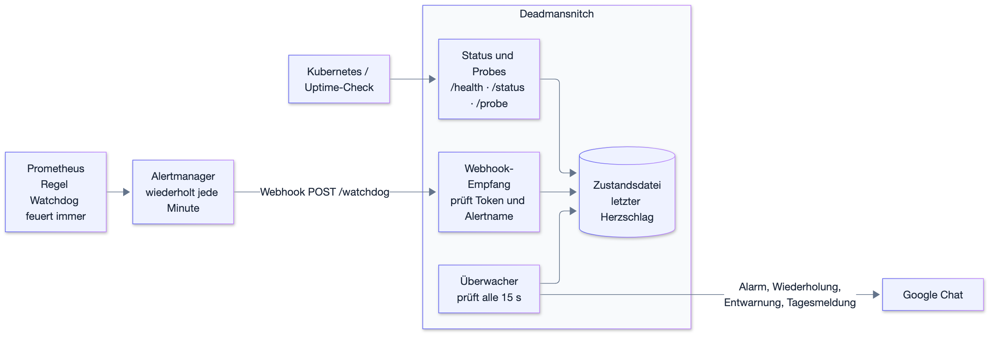
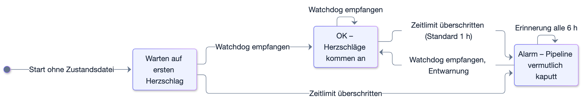

<p align="center">
  
</p>

# Deadmansnitch

[](https://github.com/serverkraken/deadmansnitch/actions/workflows/ci.yml)
[](https://github.com/serverkraken/deadmansnitch/actions/workflows/release.yml)


Deadmansnitch ist ein Totmannschalter für die Prometheus-Alarmkette: Der Dienst
wartet auf einen regelmäßigen Herzschlag von Alertmanager und schlägt auf einem
unabhängigen Weg (Google Chat) Alarm, sobald dieser Herzschlag ausbleibt.

## Überblick

Ein Monitoring, das selbst ausfällt, meldet nichts, und genau das fällt
niemandem auf. Fällt Prometheus aus, hängt Alertmanager oder ist die
Weiterleitung falsch konfiguriert, bleibt es einfach still. Deadmansnitch
dreht die Logik um: Nicht der Alarm ist das Signal, sondern sein Ausbleiben.

Prometheus feuert dazu dauerhaft einen Alarm namens `Watchdog`. Alertmanager
leitet ihn etwa jede Minute per Webhook an Deadmansnitch weiter. Solange diese
Herzschläge ankommen, ist die ganze Kette von der Regelauswertung bis zum
Versand nachweislich intakt. Kommt eine Stunde lang (einstellbar) nichts an,
schickt Deadmansnitch eine Nachricht nach Google Chat, also an Prometheus und
Alertmanager vorbei.

Der Dienst ist bewusst klein gehalten: eine Flask-Anwendung unter Gunicorn, ein
Hintergrund-Überwacher und eine JSON-Zustandsdatei. Eine Datenbank braucht er
nicht. Weil er auch nach einem Neustart weiß, wann der letzte Herzschlag kam,
verlängert ein Neustart während eines Ausfalls die Erkennungszeit nicht.

## Features

- **Herzschlag-Empfang** über `POST /watchdog` im Standard-Webhook-Format von
  Alertmanager. Auch gruppierte Payloads werden erkannt, wenn der Watchdog
  darin an beliebiger Stelle steht.
- **Alarm bei Stille:** Nach `WATCHDOG_TIMEOUT` Sekunden ohne Herzschlag geht
  eine Fehlermeldung nach Google Chat, danach alle `ALERT_RESEND_INTERVAL`
  Sekunden eine Erinnerung.
- **Entwarnung:** Kommt der Herzschlag zurück, folgt eine Recovery-Nachricht.
  Scheitert deren Versand, versucht der Überwacher es erneut.
- **Tägliche Statusmeldung**, solange alles in Ordnung ist. So fällt auch ein
  kaputter Benachrichtigungskanal auf.
- **Resolved-Meldungen zählen nicht:** Ein aufgelöster Watchdog bedeutet, dass
  die Pipeline aufgehört hat zu feuern. Er wird ignoriert und setzt den Timer
  nicht zurück.
- **Optionaler Token-Schutz:** Mit `WATCHDOG_AUTH_TOKEN` verlangt der Endpunkt
  `Authorization: Bearer <token>`. Fremde Clients können dann keine
  Herzschläge fälschen und den Schalter so stummschalten.
- **Robuster Zustand:** Die Zustandsdatei wird atomar geschrieben (temporäre
  Datei, `fsync`, Umbenennen) und per Dateisperre geschützt. Eine beschädigte
  Datei wird zur Analyse als `.corrupt` aufbewahrt.
- **Kubernetes-tauglich:** eigene Liveness- und Readiness-Probes, die auch
  prüfen, ob der Überwacher noch lebt und das Datenverzeichnis beschreibbar ist.

## Architektur

Das Bild zeigt den Weg des Herzschlags und die drei Teile im Dienst, die sich
eine Zustandsdatei teilen.



- **Prometheus und Alertmanager** liefern den Herzschlag. Eine Regel mit
  `expr: vector(1)` feuert immer, und Alertmanager wiederholt sie in kurzem
  Abstand an den Webhook.
- **Webhook-Empfang** (`POST /watchdog`) prüft den optionalen Token, sucht
  den erwarteten Alertnamen (`EXPECTED_ALERTNAME`) und vermerkt den Zeitpunkt
  in der Zustandsdatei. Fremde Alarme werden mit `400` abgewiesen, damit eine
  Fehlkonfiguration in den Metriken von Alertmanager sichtbar wird.
- **Zustandsdatei** (`watchdog_state.json` in `DATA_DIR`) enthält den letzten
  Herzschlag, den aktuellen Status, Zähler und die Zeitpunkte der letzten
  Benachrichtigungen. Sie überlebt Neustarts, deshalb gehört `DATA_DIR` auf ein
  persistentes Volume.
- **Überwacher** ist ein Hintergrund-Thread, der alle `MONITOR_INTERVAL`
  Sekunden nachsieht, wie alt der letzte Herzschlag ist, und die
  Benachrichtigungen verschickt. Unter Gunicorn startet er genau einmal im
  Master-Prozess. Seinen eigenen Herzschlag schreibt er in die Datei
  `monitor_heartbeat`, die die Readiness-Probe auswertet.
- **Status und Probes** lesen nur den Zustand und verändern ihn nie.
- **Google Chat** ist der unabhängige Meldeweg. Die Benachrichtigung ist über
  Provider gekapselt, Google Chat ist derzeit der einzige.

Der Status durchläuft dabei wenige Zustände:



Nach einem Neustart bekommt die Pipeline nur noch den Rest ihres Zeitfensters,
kein neues: Lag der letzte Herzschlag schon 50 Minuten zurück, schlägt
Deadmansnitch bei einer Stunde Timeout nach 10 Minuten Alarm.

## Installation & Nutzung

### Container

Bei jedem Release baut die CI ein Image nach
`ghcr.io/serverkraken/deadmansnitch`, getaggt mit der Release-Version. Es läuft
als Nicht-root-Benutzer, lauscht auf Port `5001`, legt seinen Zustand im Volume
`/app/data` ab und bringt einen eigenen `HEALTHCHECK` mit.

```bash
docker build -t deadmansnitch .
docker run -p 5001:5001 \
  -v deadmansnitch-data:/app/data \
  -e GOOGLE_CHAT_WEBHOOK_URL="<webhook-url>" \
  deadmansnitch
```

### Konfiguration

Alle Einstellungen kommen aus Umgebungsvariablen.

| Variable | Standard | Bedeutung |
| :--- | :--- | :--- |
| `WATCHDOG_TIMEOUT` | `3600` | Sekunden ohne Herzschlag, bis Alarm ausgelöst wird (1 Stunde). |
| `EXPECTED_ALERTNAME` | `Watchdog` | Alertname, der als Herzschlag zählt. |
| `ALERT_RESEND_INTERVAL` | `21600` | Abstand der Erinnerungen in Sekunden, solange der Alarm anhält (6 Stunden). |
| `GOOGLE_CHAT_WEBHOOK_URL` | – | Webhook für Google Chat. Ohne ihn läuft der Dienst, verschickt aber keine Benachrichtigungen. |
| `WATCHDOG_AUTH_TOKEN` | – | Optionales gemeinsames Geheimnis. Ist es gesetzt, verlangt `POST /watchdog` den Header `Authorization: Bearer <token>`. |
| `LOG_LEVEL` | `INFO` | Log-Level. Zugriffe auf `/health` und `/probe/*` erscheinen nur bei `DEBUG` im Access-Log. |
| `DATA_DIR` | `/app/data` | Verzeichnis für Zustandsdatei, Sperrdatei und Überwacher-Herzschlag. |
| `MONITOR_INTERVAL` | `15` | Takt des Überwachers in Sekunden. |
| `MAX_CONTENT_LENGTH` | `65536` | Maximale Größe eines Webhook-Bodys in Bytes; größere Anfragen enden mit `413`. |

### Prometheus einrichten

Eine Regel, die immer feuert. Sie hängt an keinem Ziel und belegt nur, dass
Prometheus läuft und Regeln auswertet.

```yaml
groups:
  - name: watchdog
    rules:
      - alert: Watchdog
        annotations:
          message: 'This is an alert meant to ensure that the entire alerting pipeline is functional.'
        expr: vector(1)
        labels:
          severity: none
```

### Alertmanager einrichten

Ein Receiver, der den Watchdog an Deadmansnitch schickt, und eine Route mit
kurzem `repeat_interval`, damit der Herzschlag häufig genug kommt. Ist
`WATCHDOG_AUTH_TOKEN` gesetzt, gehört der Token in `http_config.authorization`.

```yaml
receivers:
  - name: 'deadmansnitch-receiver'
    webhook_configs:
      - url: 'http://<deadmansnitch-host>:5001/watchdog'
        send_resolved: true
        # nur bei gesetztem WATCHDOG_AUTH_TOKEN:
        # http_config:
        #   authorization:
        #     credentials: '<token>'

route:
  routes:
    - matchers:
        - alertname = Watchdog
      receiver: 'deadmansnitch-receiver'
      group_wait: 0s
      group_interval: 1m
      repeat_interval: 1m
```

Ein Beispiel für die Payload, die Alertmanager dabei schickt, liegt in
[`example_alertmanager.json`](example_alertmanager.json).

### Endpunkte

| Methode und Pfad | Zweck |
| :--- | :--- |
| `POST /watchdog` | Webhook für Alertmanager. `200` bei gültigem Herzschlag, `400` bei fremdem oder ungültigem Alarm, `401` bei falschem Token, `413` bei zu großem Body. |
| `GET /health` | `200`, solange Herzschläge ankommen oder der Dienst noch auf den ersten wartet, sonst `503`. Gedacht für externe Uptime-Checks. |
| `GET /status` | Ausführlicher Zustand: Zähler, letzter Herzschlag mit Details, letzte Benachrichtigungen und die aktive Konfiguration. |
| `GET /probe/liveness` | Kubernetes-Liveness: Ist der Dienst initialisiert und vollständig verdrahtet? |
| `GET /probe/readiness` | Kubernetes-Readiness: nach 30 Sekunden Anlaufzeit, mit beschreibbarem Datenverzeichnis und einem Überwacher-Herzschlag, der jünger als 90 Sekunden ist. |
| `GET /` | Dienstname, Version und Liste der Endpunkte. |

## Entwicklung

### Voraussetzungen

- Python 3.10 oder neuer (das Container-Image nutzt `python:3.14-slim`)
- [Poetry](https://python-poetry.org/) für die Abhängigkeiten

```bash
git clone https://github.com/serverkraken/deadmansnitch.git
cd deadmansnitch
poetry install
```

### Lokal starten

So startet der Dienst wie im Container, nur mit einem lokalen Datenverzeichnis:

```bash
DATA_DIR=./data poetry run gunicorn -c gunicorn_config.py "app:create_app()"
```

Gunicorn läuft mit genau einem Worker (zwei Threads), weil es nur einen
Überwacher geben darf.

### Tests und Codequalität

```bash
poetry run pytest                      # Tests
poetry run pytest --cov=app tests/     # mit Coverage
poetry run ruff format .               # formatieren
poetry run ruff check --fix .          # linten
poetry run mypy .                      # Typprüfung (strict)
```

Formatierung, Lint und Typprüfung laufen zusätzlich als `pre-commit`-Hooks
(siehe `.pre-commit-config.yaml`).

### Codeaufbau

Die Schichten unter `app/` sind klar getrennt:

- `domain/` – der Zustand (`WatchdogState`) ohne jede Infrastruktur
- `persistence/` – Repository-Schnittstelle und dateibasierte Umsetzung
- `services/` – Herzschlag-Verarbeitung, Überwacher-Thread und Kubernetes-Probes
- `notifications/` – Nachrichtentexte, Notifier und Provider (Google Chat)
- `web/` – die Flask-Routen
- `bootstrap.py` – die einzige Stelle, an der alles zusammengesteckt wird

### CI und Releases

- **ci** (bei jedem Pull Request): Trivy-Scan des Dateisystems, Python-Lint und
  Tests mit einer Mindest-Coverage von 80 %.
- **release** (bei Push auf `main`): release-please pflegt Version und
  `CHANGELOG.md`. Bei einem Release baut die CI das Image, signiert es,
  erzeugt SBOM und Attestierung und scannt es mit Trivy.
- **prerelease** (manuell): baut und scannt ein Vorab-Image.
- **cleanup** (sonntags): räumt alte Images auf.

Abhängigkeiten aktualisiert Renovate, einschließlich der in der `Dockerfile`
gepinnten Poetry-Version.

## Abhängigkeiten zu anderen Repos

- [serverkraken/reusable-workflows](https://github.com/serverkraken/reusable-workflows)
  stellt alle CI-Workflows bereit (`uses:`-Referenzen in `.github/workflows/`):
  Lint, Tests, Trivy-Scans, Image-Build, Release und Aufräumen.

Eingesetzt wird der Dienst per GitOps aus den Homelab-Repos von serverkraken:
`homelab-mail-nue` betreibt Deadmansnitch, und der Alertmanager in
`homelab-study` schickt ihm den Watchdog-Herzschlag. Weil beide in
verschiedenen Clustern laufen, bemerkt Deadmansnitch auch den Ausfall des
ganzen Monitoring-Clusters.
